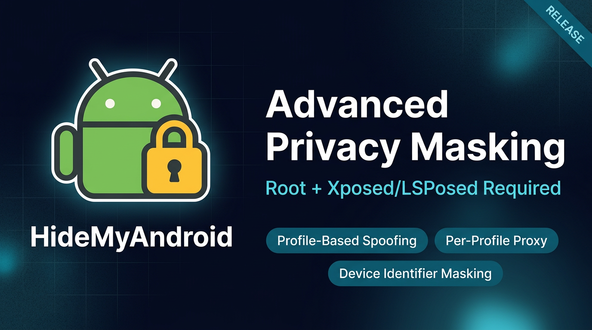

# HideMyAndroid

 

## English

[English](#english) | [简体中文](#zh-cn) | [Русская версия](#ru) | [Bahasa Indonesia](#id) | [Hinglish](#hi-latn) | [Français](#fr)

### Support/Discussion

Support: https://t.me/hidemyandroid

HideMyAndroid is a privacy-focused Android module built to reduce app tracking and device fingerprinting through profile-based masking/spoofing.

Official Website: https://www.hidemyandroid.com  
Web App / Dashboard: https://app.hidemyandroid.com  
How to install: https://www.hidemyandroid.com/en/how-to-install/

### Requirements

- Android 9.0+ (Pie or newer)
- Rooted Android device
- Properly working Xposed/LSPosed environment
- If you are not familiar with Xposed modules, this project may not be suitable for your setup.

### How It Works

When a target app requests identifiers or environment signals, HideMyAndroid intercepts the request and returns configured spoofed values based on your selected profile.

### Feature List

- Spoof Device Identifiers (Android ID, GAID, GSF ID, Widevine DRM ID, App Set ID, IMEI, Serial, ...)
- Native-Level Protection: spoofed values apply to Java APIs and to native (C/C++) code paths, so apps that read system properties, files or sensors natively see the same values
- Spoof SIM Card Info
- Spoof Mobile Number
- Hide Root
- Hide LSPosed
- Hide VPN Connection
- Hide Active Proxy Connection from Apps
- Browser Fingerprint
- Hide Airplane Mode
- Hide Wi-Fi Information (NAME/MAC)
- Spoof Nearby Wi-Fi Networks
- Spoof Nearby Bluetooth Devices
- Block LAN Scan
- Hide Developer Mode
- Headless Mode (Developer Mode)
- Spoof Play Store Installation
- Spoof Timezone Based on IP
- Spoof Region Based on IP
- Spoof GPS Location Based on IP
- Spoof App Identity
- Isolated Account Environment
- Virtual Gmail Accounts Per Profile
- Hide Installed Applications
- Realistic Sensor Data: accelerometer, gyroscope, compass and motion fusion sensors all come from one simulated motion model, while the compass, barometer and light sensor follow the profile's location, altitude and local time, so cross-checks between sensors stay consistent.
  - Magnetometer: simulate a compass field matching the profile location and device orientation.
  - Motion fusion sensors: keep gravity, linear acceleration, rotation vector and orientation consistent with the simulated motion.
  - Barometer: report air pressure that matches the spoofed location's altitude, with slow weather drift.
  - Sensor list: make the sensor list and each sensor's name, vendor, range and resolution match the simulated device.
- Spoof Device Uptime
- Device Simulation
- Hide My Emulator (add-on): running HideMyAndroid on an Android emulator? Target apps see a real phone instead
- Profile-Based System
- Backup & Restore app's data
- Cloud Profiles (Premium add-on): move profiles between phones. Back up any or all profiles with their app data, encrypted on your phone with your own password before upload, then restore them on your other phones
- Per-Profile Proxy (each profile can use its own independent proxy configuration)
- Hide Suspicious Keyboards
- Virtual Default Keyboard Value
- Many More Features

### Free vs Premium

| Features                                          | Freemium | Premium (Subscription) |
| ------------------------------------------------- | :------: | :--------------------: |
| Maximum profiles                                  |    5     |       Unlimited        |
| Maximum profile creation per day                  |  20/day  |       Unlimited        |
| Hide device identifiers                           | Partial  |          Full          |
| Native-level (C/C++) protection                   | Partial  |           ✅           |
| Backup & restore app data                         |    ✅    |           ✅           |
| Hide active VPN from apps                         |    ✅    |           ✅           |
| Spoof Wi-Fi SSID/BSSID                            |    ✅    |           ✅           |
| Hide Developer Options state                      |    ✅    |           ✅           |
| Spoof installer as Google Play                    |    ✅    |           ✅           |
| Hide installed apps list                          |    ✅    |           ✅           |
| Hide suspicious keyboards from enabled keyboard lists |    ✅    |           ✅           |
| Virtual default keyboard value spoofing           |    ✅    |           ✅           |
| Device Simulation                                 |    ✅    |           ✅           |
| Hide My Emulator (for emulators)                  |  Add-on  |         Add-on         |
| Hide active proxy connection from apps            |          |           ✅           |
| Hide Root                                         |          |           ✅           |
| Hide LSPosed                                      |          |           ✅           |
| Browser Fingerprint                               |          |           ✅           |
| Spoof SIM card info                               |          |           ✅           |
| Spoof mobile number                               |          |           ✅           |
| Hide airplane mode state from apps               |          |           ✅           |
| Spoof nearby Wi-Fi networks                       |          |           ✅           |
| Spoof nearby Bluetooth devices                    |          |           ✅           |
| Block private LAN scan behavior                   |          |           ✅           |
| Spoof timezone by geo                             |          |           ✅           |
| Spoof locale/region by geo                        |          |           ✅           |
| Spoof GPS by geo                                  |          |           ✅           |
| Spoof app identity                                |          |           ✅           |
| Virtual Gmail accounts per profile                |          |           ✅           |
| Virtual account isolation per profile             |          |           ✅           |
| Simulate accelerometer sensor data                |          |           ✅           |
| Simulate gyroscope sensor data                    |          |           ✅           |
| Simulate light sensor data                        |          |           ✅           |
| Simulate magnetometer (compass) data              |          |           ✅           |
| Simulate motion fusion sensors (gravity, rotation vector, orientation) |          |           ✅           |
| Simulate barometer (air pressure) data            |          |           ✅           |
| Match sensor list to the simulated device         |          |           ✅           |
| Spoof device uptime                               |          |           ✅           |
| Headless Mode (Developer Mode)                    |          |           ✅           |
| Backup & restore all profiles and app data (ZIP)  |          |           ✅           |
| Cloud Profiles (move profiles between phones)     |          |         Add-on         |

Location, locale, and timezone hooks apply when a proxy provides geo info — or from a custom location you set yourself, with no proxy required.

Plans & pricing: https://www.hidemyandroid.com/en/#pricing

### Important Notice

System-level modification always carries risk.  
Please back up your ROM and important data before use.

### Disclaimer

Use at your own risk.  
By installing or using HideMyAndroid, you are solely responsible for how you use it.  
The developers are not responsible for misuse, violations of laws/platform policies, account penalties, data loss, instability, or bootloops.

### Ongoing Updates

HideMyAndroid is actively maintained with continuous feature and stability updates.

### Feature Requests

Feature requests are welcome.  
If you need a specific capability, share your use case and we will prioritize based on community demand.

---

## 简体中文

[English](#english) | [简体中文](#zh-cn) | [Русская версия](#ru) | [Bahasa Indonesia](#id) | [Hinglish](#hi-latn) | [Français](#fr)

### 支持与讨论

Support: https://t.me/hidemyandroid

HideMyAndroid 是一款以隐私保护为核心的 Android 模块。它通过基于配置文件的隐藏与伪装机制，降低应用跟踪和设备指纹识别风险。

官方网站: https://www.hidemyandroid.com  
Web 应用 / 控制台: https://app.hidemyandroid.com  
安装教程: https://www.hidemyandroid.com/zh/how-to-install/

### 使用要求

- Android 9.0+（Pie 或更高版本）
- 已 Root 的 Android 设备
- 可正常运行的 Xposed/LSPosed 环境
- 如果你不熟悉 Xposed 模块，本项目可能不适合你的设备环境。

### 工作机制

当目标应用请求设备标识符或环境信号时，HideMyAndroid 会拦截请求，并根据你选择的配置文件返回已设置的伪装值。

### 功能一览

- 伪装设备标识符（Android ID、GAID、GSF ID、Widevine DRM ID、App Set ID、IMEI、Serial 等）
- 原生层保护：伪装的值同时作用于 Java API 和原生（C/C++）代码路径，因此以原生方式读取系统属性、文件或传感器的应用也会看到相同的值
- 伪装 SIM 卡信息
- 伪装手机号
- 隐藏 Root
- 隐藏 LSPosed
- 隐藏 VPN 连接状态
- 对应用隐藏当前代理连接状态
- 浏览器指纹
- 隐藏飞行模式状态
- 隐藏 Wi-Fi 信息（名称/MAC）
- 伪造附近 Wi-Fi 网络
- 伪造附近蓝牙设备
- 阻止局域网扫描
- 隐藏开发者模式状态
- 无头模式（开发者模式）
- 伪装为通过 Play 商店安装
- 基于 IP 伪装时区
- 基于 IP 伪装地区
- 基于 IP 伪装 GPS 位置
- 伪装应用身份
- 账号隔离环境
- 每个配置文件使用虚拟 Gmail 账号
- 隐藏已安装应用列表
- 拟真的传感器数据：加速度计、陀螺仪、磁力计和运动融合传感器均来自同一个模拟运动模型，而磁力计、气压计和光线传感器会跟随配置文件的位置、海拔和当地时间，使各传感器之间的交叉校验保持一致。
  - 磁力计：模拟与配置文件位置和设备朝向一致的指南针磁场。
  - 运动融合传感器：使重力、线性加速度、旋转矢量和方向与模拟运动保持一致。
  - 气压计：报告与模拟位置海拔一致的气压，并带有缓慢的天气漂移。
  - 传感器列表：让传感器列表及每个传感器的名称、厂商、量程和分辨率与模拟设备一致。
- 伪装设备运行时间
- 设备模拟
- Hide My Emulator（附加功能）：在 Android 模拟器上运行 HideMyAndroid？让目标应用看到真机而不是模拟器
- 基于配置文件的系统
- 备份与恢复应用数据
- Cloud Profiles（Premium 附加功能）：在手机之间迁移配置文件。将部分或全部配置文件（包括已保存的应用数据）备份到云端，上传前会在您的手机上用您自己设置的密码加密，之后可在您的其他手机上恢复
- 按配置文件设置代理（每个配置文件可使用独立代理配置）
- 隐藏可疑键盘
- 虚拟默认键盘值
- 更多功能持续更新

### 免费版 vs 高级版

| 功能                                               | 免费版 | 高级版（订阅） |
| -------------------------------------------------- | :----: | :------------: |
| 最大配置文件数量                                   |  5 个  |      无限      |
| 每日最大创建配置数                                 | 20 个/天 |      无限      |
| 隐藏设备标识符                                     |  部分  |      完全      |
| 原生层（C/C++）保护                                |  部分  |       ✅       |
| 备份与恢复应用数据                                 |   ✅   |       ✅       |
| 对应用隐藏当前 VPN 状态                            |   ✅   |       ✅       |
| 伪装 Wi-Fi SSID/BSSID                              |   ✅   |       ✅       |
| 隐藏开发者选项状态                                 |   ✅   |       ✅       |
| 伪装安装来源为 Google Play                         |   ✅   |       ✅       |
| 隐藏已安装应用列表                                 |   ✅   |       ✅       |
| 在已启用键盘列表中隐藏可疑键盘                     |   ✅   |       ✅       |
| 虚拟默认键盘值伪装                                 |   ✅   |       ✅       |
| 设备模拟                                           |   ✅   |       ✅       |
| Hide My Emulator（适用于模拟器）                   | 附加功能 |    附加功能    |
| 对应用隐藏当前代理连接状态                         |        |       ✅       |
| 隐藏 Root                                          |        |       ✅       |
| 隐藏 LSPosed                                       |        |       ✅       |
| 浏览器指纹                                         |        |       ✅       |
| 伪装 SIM 卡信息                                    |        |       ✅       |
| 伪装手机号                                         |        |       ✅       |
| 对应用隐藏飞行模式状态                            |        |       ✅       |
| 伪造附近 Wi-Fi 网络                                |        |       ✅       |
| 伪造附近蓝牙设备                                   |        |       ✅       |
| 阻止私有局域网扫描行为                             |        |       ✅       |
| 按地理位置伪装时区                                 |        |       ✅       |
| 按地理位置伪装语言区域/地区                        |        |       ✅       |
| 按地理位置伪装 GPS                                 |        |       ✅       |
| 伪装应用身份                                       |        |       ✅       |
| 每个配置文件使用虚拟 Gmail 账号                    |        |       ✅       |
| 每个配置文件的虚拟账号隔离                         |        |       ✅       |
| 模拟加速度传感器数据                               |        |       ✅       |
| 模拟陀螺仪传感器数据                               |        |       ✅       |
| 模拟光线传感器数据                                |        |       ✅       |
| 模拟磁力计（指南针）数据                           |        |       ✅       |
| 模拟运动融合传感器（重力、旋转矢量、方向）         |        |       ✅       |
| 模拟气压计（气压）数据                             |        |       ✅       |
| 传感器列表与模拟设备匹配                           |        |       ✅       |
| 伪装设备运行时间                                   |        |       ✅       |
| 无头模式（开发者模式）                             |        |       ✅       |
| 备份与恢复全部配置文件及应用数据（ZIP）            |        |       ✅       |
| Cloud Profiles（在手机之间迁移配置文件）           |        |    附加功能    |

位置、语言和时区 Hook 在代理提供地理位置信息时生效 — 也可使用您自行设置的自定义位置，无需代理。

套餐与价格: https://www.hidemyandroid.com/zh/#pricing

### 重要提示

系统级修改始终存在风险。  
使用前请先备份 ROM 和重要数据。

### 免责声明

请自行承担使用风险。  
安装或使用 HideMyAndroid，即表示你需对其使用方式承担全部责任。  
对于误用、违反法律/平台政策、账号处罚、数据丢失、系统不稳定或开机循环（bootloop），开发者不承担责任。

### 持续更新

HideMyAndroid 正在持续维护，并不断进行功能与稳定性更新。

### 功能建议

欢迎提交功能建议。  
如果你需要特定能力，请分享你的使用场景，我们会根据社区需求优先级进行评估。

---

## Русская версия

[English](#english) | [简体中文](#zh-cn) | [Русская версия](#ru) | [Bahasa Indonesia](#id) | [Hinglish](#hi-latn) | [Français](#fr)

### Поддержка / Обсуждение

Support: https://t.me/hidemyandroid

HideMyAndroid — это модуль Android, ориентированный на конфиденциальность, созданный для снижения отслеживания приложений и идентификации устройства по отпечатку через маскировку/подмену на основе профилей.

Официальный сайт: https://www.hidemyandroid.com  
Веб-приложение / Панель управления: https://app.hidemyandroid.com  
Инструкция по установке: https://www.hidemyandroid.com/ru/how-to-install/

### Требования

- Android 9.0+ (Pie или новее)
- Android-устройство с root-доступом
- Корректно работающая среда Xposed/LSPosed
- Если вы не знакомы с модулями Xposed, этот проект может не подойти для вашей конфигурации.

### Как это работает

Когда целевое приложение запрашивает идентификаторы или сигналы окружения, HideMyAndroid перехватывает запрос и возвращает заранее настроенные подменённые значения в зависимости от выбранного профиля.

### Список функций

- Подмена идентификаторов устройства (Android ID, GAID, GSF ID, Widevine DRM ID, App Set ID, IMEI, серийный номер и др.)
- Защита на нативном уровне: подменённые значения применяются и к Java API, и к нативному (C/C++) коду, поэтому приложения, которые читают системные свойства, файлы или датчики нативно, видят те же значения
- Подмена данных SIM-карты
- Подмена номера телефона
- Скрытие Root
- Скрытие LSPosed
- Скрытие VPN-соединения
- Скрытие активного прокси-соединения от приложений
- Отпечаток браузера
- Скрытие режима полёта
- Скрытие информации о Wi-Fi (имя/MAC)
- Подмена ближайших сетей Wi-Fi
- Подмена ближайших Bluetooth-устройств
- Блокировка сканирования локальной сети
- Скрытие режима разработчика
- Headless-режим (Режим разработчика)
- Подмена факта установки через Play Маркет
- Подмена часового пояса по IP
- Подмена региона по IP
- Подмена GPS-координат по IP
- Подмена идентичности приложения
- Изолированная среда для аккаунтов
- Виртуальные аккаунты Gmail для каждого профиля
- Скрытие списка установленных приложений
- Реалистичные данные сенсоров: акселерометр, гироскоп, магнитометр и датчики слияния движения используют одну имитируемую модель движения, а магнитометр, барометр и датчик освещённости следуют местоположению, высоте и местному времени профиля, поэтому перекрёстные проверки между датчиками остаются согласованными.
  - Магнитометр: имитирует магнитное поле компаса по местоположению профиля и ориентации устройства.
  - Датчики слияния движения: согласует гравитацию, линейное ускорение, вектор вращения и ориентацию с имитируемым движением.
  - Барометр: сообщает атмосферное давление, соответствующее высоте подменённого местоположения, с медленным погодным дрейфом.
  - Список датчиков: список датчиков и имя, производитель, диапазон и разрешение каждого датчика соответствуют имитируемому устройству.
- Подмена времени работы устройства
- Симуляция устройства
- Hide My Emulator (дополнение): запускаете HideMyAndroid на Android-эмуляторе? Целевые приложения видят настоящий телефон вместо эмулятора
- Система на основе профилей
- Резервное копирование и восстановление данных приложений
- Cloud Profiles (Premium-дополнение): переносите профили между телефонами. Сохраняйте в облако любые или все профили вместе с сохранёнными данными приложений: они шифруются на вашем телефоне вашим собственным паролем ещё до загрузки. Затем восстанавливайте их на других своих телефонах
- Прокси для каждого профиля (каждый профиль может использовать собственную независимую конфигурацию прокси)
- Скрытие подозрительных клавиатур
- Виртуальное значение клавиатуры по умолчанию
- И многие другие функции

### Бесплатно vs Премиум

| Функции                                                           | Бесплатно | Премиум (Подписка) |
| ----------------------------------------------------------------- | :-------: | :----------------: |
| Максимальное количество профилей                                  |     5     |  Без ограничений   |
| Максимальное количество создаваемых профилей в день               |  20/день  |  Без ограничений   |
| Скрытие идентификаторов устройства                                | Ограниченно |       Полное       |
| Защита на нативном уровне (C/C++)                                 | Ограниченно |         ✅         |
| Резервное копирование и восстановление данных приложений          |    ✅     |         ✅         |
| Скрытие активного VPN от приложений                               |    ✅     |         ✅         |
| Подмена Wi-Fi SSID/BSSID                                          |    ✅     |         ✅         |
| Скрытие состояния «Параметры разработчика»                        |    ✅     |         ✅         |
| Подмена установщика на Google Play                                |    ✅     |         ✅         |
| Скрытие списка установленных приложений                           |    ✅     |         ✅         |
| Скрытие подозрительных клавиатур из списка активных               |    ✅     |         ✅         |
| Подмена виртуального значения клавиатуры по умолчанию             |    ✅     |         ✅         |
| Симуляция устройства                                              |    ✅     |         ✅         |
| Hide My Emulator (для эмуляторов)                                 | Дополнение |     Дополнение     |
| Скрытие активного прокси-соединения от приложений                 |           |         ✅         |
| Скрытие Root                                                      |           |         ✅         |
| Скрытие LSPosed                                                   |           |         ✅         |
| Отпечаток браузера                                                |           |         ✅         |
| Подмена данных SIM-карты                                          |           |         ✅         |
| Подмена номера телефона                                           |           |         ✅         |
| Скрытие режима полёта от приложений                               |           |         ✅         |
| Подмена ближайших сетей Wi-Fi                                     |           |         ✅         |
| Подмена ближайших Bluetooth-устройств                             |           |         ✅         |
| Блокировка сканирования локальной сети                            |           |         ✅         |
| Подмена часового пояса по геолокации                              |           |         ✅         |
| Подмена локали/региона по геолокации                              |           |         ✅         |
| Подмена GPS по геолокации                                         |           |         ✅         |
| Подмена идентичности приложения                                   |           |         ✅         |
| Виртуальные аккаунты Gmail для каждого профиля                    |           |         ✅         |
| Изоляция виртуальных аккаунтов для каждого профиля                |           |         ✅         |
| Симуляция данных акселерометра                                    |           |         ✅         |
| Симуляция данных гироскопа                                        |           |         ✅         |
| Симуляция данных датчика освещённости                             |           |         ✅         |
| Симуляция данных магнитометра (компас)                            |           |         ✅         |
| Симуляция датчиков слияния движения (гравитация, вектор вращения, ориентация) |           |         ✅         |
| Симуляция данных барометра (атмосферное давление)                 |           |         ✅         |
| Список датчиков как у симулируемого устройства                    |           |         ✅         |
| Подмена времени работы устройства                                 |           |         ✅         |
| Headless-режим (Режим разработчика)                               |           |         ✅         |
| Бэкап и восстановление всех профилей и данных приложений (ZIP)    |           |         ✅         |
| Cloud Profiles (перенос профилей между телефонами)                |           |     Дополнение     |

Хуки местоположения, региона и часового пояса применяются при наличии геоинформации у прокси — либо с произвольным местоположением, которое вы задаёте сами, без прокси.

Тарифы и цены: https://www.hidemyandroid.com/ru/#pricing

### Важное уведомление

Любое изменение на системном уровне всегда сопряжено с риском.  
Перед использованием обязательно создайте резервную копию ROM и важных данных.

### Отказ от ответственности

Используйте на свой страх и риск.  
Устанавливая или используя HideMyAndroid, вы несёте полную ответственность за способ его применения.  
Разработчики не несут ответственности за неправомерное использование, нарушение законов / правил платформ, блокировку аккаунтов, потерю данных, нестабильность или bootloop.

### Постоянные обновления

HideMyAndroid активно поддерживается с непрерывными обновлениями функций и стабильности.

### Запросы функций

Запросы новых функций приветствуются.  
Если вам нужна определённая возможность, опишите ваш сценарий использования, и мы расставим приоритеты на основе спроса сообщества.

---

## Bahasa Indonesia

[English](#english) | [简体中文](#zh-cn) | [Русская версия](#ru) | [Bahasa Indonesia](#id) | [Hinglish](#hi-latn) | [Français](#fr)

### Dukungan / Diskusi

Support: https://t.me/hidemyandroid

HideMyAndroid adalah modul Android yang berfokus pada privasi, dibuat untuk mengurangi pelacakan aplikasi dan sidik jari perangkat (device fingerprinting) melalui penyamaran/pemalsuan berbasis profil.

Situs Resmi: https://www.hidemyandroid.com  
Aplikasi Web / Dasbor: https://app.hidemyandroid.com  
Cara instalasi: https://www.hidemyandroid.com/id/how-to-install/

### Persyaratan

- Android 9.0+ (Pie atau lebih baru)
- Perangkat Android yang sudah di-root
- Lingkungan Xposed/LSPosed yang berfungsi dengan baik
- Jika Anda tidak terbiasa dengan modul Xposed, proyek ini mungkin tidak cocok untuk konfigurasi Anda.

### Cara Kerja

Ketika aplikasi target meminta identifier atau sinyal lingkungan, HideMyAndroid akan mencegat permintaan tersebut dan mengembalikan nilai palsu yang telah dikonfigurasi sesuai dengan profil yang Anda pilih.

### Daftar Fitur

- Memalsukan Identifier Perangkat (Android ID, GAID, GSF ID, Widevine DRM ID, App Set ID, IMEI, Serial, ...)
- Perlindungan Tingkat Native: nilai palsu diterapkan pada API Java dan jalur kode native (C/C++), sehingga aplikasi yang membaca properti sistem, file, atau sensor secara native melihat nilai yang sama
- Memalsukan Info Kartu SIM
- Memalsukan Nomor Ponsel
- Sembunyikan Root
- Sembunyikan LSPosed
- Sembunyikan Koneksi VPN
- Sembunyikan Koneksi Proxy Aktif dari Aplikasi
- Sidik Jari Browser
- Sembunyikan Mode Pesawat
- Sembunyikan Informasi Wi-Fi (NAMA/MAC)
- Memalsukan Jaringan Wi-Fi di Sekitar
- Memalsukan Perangkat Bluetooth di Sekitar
- Blokir Pemindaian LAN
- Sembunyikan Mode Pengembang
- Mode Headless (Mode Pengembang)
- Memalsukan Instalasi dari Play Store
- Memalsukan Zona Waktu Berdasarkan IP
- Memalsukan Wilayah Berdasarkan IP
- Memalsukan Lokasi GPS Berdasarkan IP
- Memalsukan Identitas Aplikasi
- Lingkungan Akun Terisolasi
- Akun Gmail Virtual Per Profil
- Sembunyikan Aplikasi Terpasang
- Data Sensor Realistis: akselerometer, giroskop, magnetometer, dan sensor fusi gerak berasal dari satu model gerakan simulasi, sedangkan magnetometer, barometer, dan sensor cahaya mengikuti lokasi, ketinggian, dan waktu lokal profil, sehingga pemeriksaan silang antar sensor tetap konsisten.
  - Magnetometer: menyimulasikan medan kompas sesuai lokasi profil dan orientasi perangkat.
  - Sensor fusi gerak: menjaga gravitasi, akselerasi linear, rotation vector, dan orientasi konsisten dengan gerakan simulasi.
  - Barometer: melaporkan tekanan udara yang sesuai dengan ketinggian lokasi palsu, dengan pergeseran cuaca yang lambat.
  - Daftar sensor: membuat daftar sensor serta nama, vendor, jangkauan, dan resolusi tiap sensor sesuai perangkat simulasi.
- Memalsukan Waktu Aktif Perangkat
- Simulasi Perangkat
- Hide My Emulator (add-on): menjalankan HideMyAndroid di emulator Android? Aplikasi target melihat ponsel asli, bukan emulator
- Sistem Berbasis Profil
- Pencadangan & Pemulihan data aplikasi
- Cloud Profiles (add-on Premium): pindahkan profil antar ponsel. Cadangkan sebagian atau semua profil, termasuk data aplikasi yang tersimpan, ke cloud. Data dienkripsi di ponsel Anda dengan kata sandi Anda sendiri sebelum diunggah, lalu bisa dipulihkan di ponsel Anda yang lain
- Proxy Per Profil (setiap profil dapat menggunakan konfigurasi proxy independennya sendiri)
- Sembunyikan Keyboard Mencurigakan
- Nilai Keyboard Default Virtual
- Dan Banyak Fitur Lainnya

### Gratis vs Premium

| Fitur                                                  | Freemium | Premium (Langganan) |
| ------------------------------------------------------ | :------: | :-----------------: |
| Jumlah maksimum profil                                 |    5     |     Tak terbatas     |
| Maksimum pembuatan profil per hari                     | 20/hari  |     Tak terbatas     |
| Sembunyikan pengidentifikasi perangkat                 | Sebagian |        Penuh         |
| Perlindungan tingkat native (C/C++)                    | Sebagian |          ✅          |
| Pencadangan & pemulihan data aplikasi                  |    ✅    |          ✅          |
| Sembunyikan VPN aktif dari aplikasi                    |    ✅    |          ✅          |
| Memalsukan Wi-Fi SSID/BSSID                            |    ✅    |          ✅          |
| Sembunyikan status Opsi Pengembang                     |    ✅    |          ✅          |
| Memalsukan installer sebagai Google Play               |    ✅    |          ✅          |
| Sembunyikan daftar aplikasi terpasang                  |    ✅    |          ✅          |
| Sembunyikan keyboard mencurigakan dari daftar keyboard aktif |    ✅    |          ✅          |
| Pemalsuan nilai keyboard default virtual               |    ✅    |          ✅          |
| Simulasi Perangkat                                     |    ✅    |          ✅          |
| Hide My Emulator (untuk emulator)                      |  Add-on  |        Add-on        |
| Sembunyikan koneksi proxy aktif dari aplikasi          |          |          ✅          |
| Sembunyikan Root                                       |          |          ✅          |
| Sembunyikan LSPosed                                    |          |          ✅          |
| Sidik Jari Browser                                     |          |          ✅          |
| Memalsukan info kartu SIM                              |          |          ✅          |
| Memalsukan nomor ponsel                                |          |          ✅          |
| Sembunyikan status mode pesawat dari aplikasi          |          |          ✅          |
| Memalsukan jaringan Wi-Fi di sekitar                   |          |          ✅          |
| Memalsukan perangkat Bluetooth di sekitar              |          |          ✅          |
| Blokir perilaku pemindaian LAN privat                  |          |          ✅          |
| Memalsukan zona waktu berdasarkan geo                  |          |          ✅          |
| Memalsukan locale/wilayah berdasarkan geo              |          |          ✅          |
| Memalsukan GPS berdasarkan geo                         |          |          ✅          |
| Memalsukan identitas aplikasi                          |          |          ✅          |
| Akun Gmail virtual per profil                          |          |          ✅          |
| Isolasi akun virtual per profil                        |          |          ✅          |
| Simulasikan data sensor akselerometer                  |          |          ✅          |
| Simulasikan data sensor giroskop                       |          |          ✅          |
| Simulasikan data sensor cahaya                         |          |          ✅          |
| Simulasikan data magnetometer (kompas)                 |          |          ✅          |
| Simulasikan sensor fusi gerak (gravitasi, vektor rotasi, orientasi) |          |          ✅          |
| Simulasikan data barometer (tekanan udara)             |          |          ✅          |
| Daftar sensor sesuai perangkat yang disimulasikan      |          |          ✅          |
| Memalsukan waktu aktif perangkat                       |          |          ✅          |
| Mode Headless (Mode Pengembang)                        |          |          ✅          |
| Cadangkan & pulihkan semua profil dan data aplikasi (ZIP) |          |          ✅          |
| Cloud Profiles (pindahkan profil antar ponsel)         |          |        Add-on        |

Hook lokasi, lokal, dan zona waktu berlaku ketika proxy menyediakan informasi geo — atau dari lokasi kustom yang Anda tetapkan sendiri, tanpa memerlukan proxy.

Paket & harga: https://www.hidemyandroid.com/id/#pricing

### Pemberitahuan Penting

Modifikasi tingkat sistem selalu membawa risiko.  
Harap cadangkan ROM dan data penting Anda sebelum digunakan.

### Penafian

Gunakan dengan risiko Anda sendiri.  
Dengan memasang atau menggunakan HideMyAndroid, Anda sepenuhnya bertanggung jawab atas cara Anda menggunakannya.  
Pengembang tidak bertanggung jawab atas penyalahgunaan, pelanggaran hukum/kebijakan platform, penalti akun, kehilangan data, ketidakstabilan, atau bootloop.

### Pembaruan Berkelanjutan

HideMyAndroid dikelola secara aktif dengan pembaruan fitur dan stabilitas yang berkelanjutan.

### Permintaan Fitur

Permintaan fitur sangat diterima.  
Jika Anda membutuhkan kemampuan tertentu, bagikan kasus penggunaan Anda dan kami akan memprioritaskannya berdasarkan permintaan komunitas.

---

## Hinglish

[English](#english) | [简体中文](#zh-cn) | [Русская версия](#ru) | [Bahasa Indonesia](#id) | [Hinglish](#hi-latn) | [Français](#fr)

### Support / Discussion

Support: https://t.me/hidemyandroid

HideMyAndroid ek privacy-focused Android module hai jo profile-based masking/spoofing ke through app tracking aur device fingerprinting kam karne ke liye banaya gaya hai.

Official Website: https://www.hidemyandroid.com  
Web App / Dashboard: https://app.hidemyandroid.com  
Installation Guide: https://www.hidemyandroid.com/hi-latn/how-to-install/

### Requirements

- Android 9.0+ (Pie ya naya)
- Rooted Android device
- Sahi se kaam karta hua Xposed/LSPosed environment
- Agar aap Xposed modules se familiar nahi hain, to yeh project aapke setup ke liye sahi nahi ho sakta.

### Yeh kaise kaam karta hai

Jab koi target app identifiers ya environment signals maangta hai, HideMyAndroid us request ko intercept karta hai aur aapke chune hue profile ke hisaab se configured spoofed values return karta hai.

### Feature List

- Device Identifiers spoof karein (Android ID, GAID, GSF ID, Widevine DRM ID, App Set ID, IMEI, Serial, ...)
- Native-Level Protection: spoof ki gayi values Java APIs aur native (C/C++) code paths dono par lagti hain, isliye jo apps system properties, files ya sensors ko natively padhte hain unhe bhi wahi values dikhti hain
- SIM Info spoof karein
- Mobile Number spoof karein
- Root chhupayein
- LSPosed chhupayein
- VPN Connection chhupayein
- Apps se Active Proxy Connection chhupayein
- Browser Fingerprint
- Airplane Mode chhupayein
- Wi-Fi Information chhupayein (NAME/MAC)
- Aas-paas ke Wi-Fi Networks spoof karein
- Aas-paas ke Bluetooth Devices spoof karein
- LAN Scan block karein
- Developer Mode chhupayein
- Headless Mode (Developer Mode)
- Play Store Installation spoof karein
- IP ke hisaab se Timezone spoof karein
- IP ke hisaab se Region spoof karein
- IP ke hisaab se GPS Location spoof karein
- App Identity spoof karein
- Alag-alag Account Environment
- Gmail Accounts spoof karein (har profile ke liye alag)
- Installed Apps chhupayein
- Real lagne wala Sensor Data: accelerometer, gyroscope, compass aur motion fusion sensors sab ek hi simulated motion model se aate hain, jabki compass, barometer aur light sensor profile ki location, altitude aur local time ko follow karte hain, isliye sensors ke beech cross-checks consistent rehte hain.
  - Magnetometer: profile location aur device orientation se match karta compass field simulate karta hai.
  - Motion fusion sensors: gravity, linear acceleration, rotation vector aur orientation ko simulated motion ke saath consistent rakhta hai.
  - Barometer: spoofed location ki altitude se match karta air pressure report karta hai, dheere-dheere badalte weather drift ke saath.
  - Sensor list: sensor list aur har sensor ka name, vendor, range aur resolution simulated device se match karta hai.
- Device Uptime spoof karein
- Device Simulation
- Hide My Emulator (add-on): HideMyAndroid ko Android emulator par chala rahe hain? Target apps ko emulator ki jagah asli phone dikhta hai
- Profile-Based System
- App data ka Backup aur Restore
- Cloud Profiles (Premium add-on): profiles ko phones ke beech le jayein. Kuch ya saare profiles ka, unke saved app data ke saath, cloud par backup lein. Upload se pehle yeh aapke phone par hi aapke apne password se encrypt hota hai, phir aap ise apne doosre phones par restore kar sakte hain
- Har Profile ka apna Proxy (har profile apna independent proxy configuration use kar sakta hai)
- Suspicious Keyboards chhupayein
- Virtual Default Keyboard Value
- Aur bhi bahut Features

### Free vs Premium

| Feature                                                    | Freemium | Premium (Subscription) |
| ---------------------------------------------------------- | :------: | :--------------------: |
| Maximum profiles                                           |    5     |       Unlimited        |
| Ek din mein maximum profile banana                         |  20/din  |       Unlimited        |
| Device identifiers chhupayein                              | Partial  |          Full          |
| Native-level (C/C++) protection                            | Partial  |           ✅           |
| Profile data backup aur restore karein                     |    ✅    |           ✅           |
| Apps se active VPN chhupayein                              |    ✅    |           ✅           |
| Wi-Fi SSID/BSSID spoof karein                              |    ✅    |           ✅           |
| Developer Options state chhupayein                         |    ✅    |           ✅           |
| Installer ko Google Play jaisa spoof karein                |    ✅    |           ✅           |
| Installed apps ki list chhupayein                          |    ✅    |           ✅           |
| Suspicious keyboards chhupayein                            |    ✅    |           ✅           |
| Virtual default keyboard value                             |    ✅    |           ✅           |
| Device simulation                                          |    ✅    |           ✅           |
| Hide My Emulator (emulators ke liye)                       |  Add-on  |         Add-on         |
| Apps se active proxy connection chhupayein                 |          |           ✅           |
| Root chhupayein                                            |          |           ✅           |
| LSPosed chhupayein                                         |          |           ✅           |
| Browser Fingerprint                                        |          |           ✅           |
| SIM card info spoof karein                                 |          |           ✅           |
| Mobile number spoof karein                                 |          |           ✅           |
| Airplane Mode state chhupayein                             |          |           ✅           |
| Aas-paas ke Wi-Fi networks spoof karein                    |          |           ✅           |
| Aas-paas ke Bluetooth devices spoof karein                 |          |           ✅           |
| Private LAN scan behavior block karein                     |          |           ✅           |
| Geo ke hisaab se timezone spoof karein                     |          |           ✅           |
| Geo ke hisaab se locale/region spoof karein                |          |           ✅           |
| Geo ke hisaab se GPS spoof karein                          |          |           ✅           |
| App identity spoof karein                                  |          |           ✅           |
| Gmail Accounts spoof karein                                |          |           ✅           |
| Har profile ke liye virtual account isolation              |          |           ✅           |
| Accelerometer sensor data simulate karein                  |          |           ✅           |
| Gyroscope sensor data simulate karein                      |          |           ✅           |
| Light sensor data simulate karein                          |          |           ✅           |
| Magnetometer (compass) data simulate karein                |          |           ✅           |
| Motion fusion sensors simulate karein (gravity, rotation vector, orientation) |          |           ✅           |
| Barometer (air pressure) data simulate karein              |          |           ✅           |
| Sensor list ko simulated device se match karein            |          |           ✅           |
| Device uptime spoof karein                                 |          |           ✅           |
| Headless Mode (ADB se control)                             |          |           ✅           |
| Saare profiles aur app data ka backup aur restore (ZIP)    |          |           ✅           |
| Cloud Profiles (profiles ko phones ke beech le jayein)     |          |         Add-on         |

Location, locale aur timezone hooks tab apply hote hain jab proxy geo info deta ho — ya phir aapki khud set ki hui custom location se, bina kisi proxy ke.

Plans aur pricing: https://www.hidemyandroid.com/hi-latn/#pricing

### Zaroori Suchna

System-level modification mein hamesha risk hota hai.  
Use karne se pehle apne ROM aur zaroori data ka backup zaroor lein.

### Disclaimer

Apne risk par use karein.  
HideMyAndroid install ya use karke, aap iske use ke tareeke ke liye poori tarah khud zimmedar hain.  
Developers misuse, laws/platform policies ke violation, account penalties, data loss, instability ya bootloops ke liye zimmedar nahi hain.

### Lagataar Updates

HideMyAndroid actively maintained hai aur ismein lagataar feature aur stability updates aate rehte hain.

### Feature Requests

Feature requests ka swagat hai.  
Agar aapko koi khaas capability chahiye, to apna use case share karein aur hum community demand ke hisaab se priority denge.

---

## Français

[English](#english) | [简体中文](#zh-cn) | [Русская версия](#ru) | [Bahasa Indonesia](#id) | [Hinglish](#hi-latn) | [Français](#fr)

### Support / Discussion

Support: https://t.me/hidemyandroid

HideMyAndroid est un module Android axé sur la confidentialité, conçu pour réduire le pistage par les applications et l'identification de l'appareil par empreinte (device fingerprinting) grâce au masquage et à la falsification par profil.

Site officiel : https://www.hidemyandroid.com  
Application web / Tableau de bord : https://app.hidemyandroid.com  
Guide d'installation : https://www.hidemyandroid.com/fr/how-to-install/

### Prérequis

- Android 9.0+ (Pie ou plus récent)
- Appareil Android rooté
- Environnement Xposed/LSPosed fonctionnel
- Si vous ne connaissez pas les modules Xposed, ce projet risque de ne pas convenir à votre configuration.

### Fonctionnement

Lorsqu'une application ciblée demande des identifiants ou des signaux d'environnement, HideMyAndroid intercepte la requête et renvoie les valeurs falsifiées configurées selon le profil sélectionné.

### Liste des fonctionnalités

- Falsifier les identifiants de l'appareil (Android ID, GAID, GSF ID, Widevine DRM ID, App Set ID, IMEI, numéro de série, ...)
- Protection au niveau natif : les valeurs falsifiées s'appliquent aux API Java et au code natif (C/C++), si bien que les applications qui lisent nativement les propriétés système, les fichiers ou les capteurs voient les mêmes valeurs
- Falsifier les infos SIM
- Falsifier le numéro de mobile
- Masquer le root
- Masquer LSPosed
- Masquer la connexion VPN
- Masquer la connexion proxy active aux applications
- Empreinte de navigateur
- Masquer le mode avion
- Masquer les informations Wi-Fi (nom/MAC)
- Falsifier les réseaux Wi-Fi à proximité
- Falsifier les appareils Bluetooth à proximité
- Bloquer le scan du réseau local
- Masquer le mode développeur
- Mode headless (mode développeur)
- Falsifier l'installation via le Play Store
- Fuseau horaire basé sur l'IP
- Région basée sur l'IP
- Position GPS basée sur l'IP
- Falsifier l'identité des applications
- Environnement de comptes isolé
- Falsifier les comptes Gmail (séparément pour chaque profil)
- Masquer les applications installées
- Données de capteurs réalistes : l'accéléromètre, le gyroscope, la boussole et les capteurs de mouvement fusionnés proviennent tous d'un même modèle de mouvement simulé, tandis que la boussole, le baromètre et le capteur de luminosité suivent la position, l'altitude et l'heure locale du profil, afin que les vérifications croisées entre capteurs restent cohérentes.
  - Magnétomètre : simule un champ magnétique de boussole correspondant à la position du profil et à l'orientation de l'appareil.
  - Capteurs de mouvement fusionnés : garde la gravité, l'accélération linéaire, le vecteur de rotation et l'orientation cohérents avec le mouvement simulé.
  - Baromètre : indique une pression atmosphérique correspondant à l'altitude de la position falsifiée, avec une lente dérive météorologique.
  - Liste des capteurs : aligne la liste des capteurs ainsi que le nom, le fabricant, la plage et la résolution de chaque capteur sur l'appareil simulé.
- Falsifier la durée de fonctionnement
- Simulation d'appareil
- Hide My Emulator (module) : vous utilisez HideMyAndroid sur un émulateur Android ? Les applications ciblées voient un vrai téléphone au lieu d'un émulateur
- Système basé sur les profils
- Sauvegarde et restauration des données d'applications
- Cloud Profiles (module Premium) : déplacez vos profils d'un téléphone à l'autre. Sauvegardez dans le cloud certains ou tous vos profils, y compris les données d'applications enregistrées, chiffrés sur votre téléphone avec votre propre mot de passe avant l'envoi, puis restaurez-les sur vos autres téléphones
- Proxy par profil (chaque profil peut utiliser sa propre configuration de proxy indépendante)
- Masquer les claviers suspects
- Valeur de clavier par défaut virtuelle
- Et bien plus encore

### Free ou Premium

| Fonctionnalité                                             | Freemium | Premium (abonnement) |
| ---------------------------------------------------------- | :------: | :------------------: |
| Nombre maximal de profils                                  |    5     |       Illimité       |
| Nombre maximal de profils créés par jour                   | 20/jour  |       Illimité       |
| Masquer les identifiants de l'appareil                     | Partiel  |       Complet        |
| Protection au niveau natif (C/C++)                         | Partiel  |          ✅          |
| Sauvegarder et restaurer les données des profils           |    ✅    |          ✅          |
| Masquer le VPN actif aux applications                      |    ✅    |          ✅          |
| Falsifier le SSID/BSSID Wi-Fi                              |    ✅    |          ✅          |
| Masquer l'état des options pour les développeurs           |    ✅    |          ✅          |
| Faire passer l'installateur pour Google Play               |    ✅    |          ✅          |
| Masquer la liste des applications installées               |    ✅    |          ✅          |
| Masquer les claviers suspects                              |    ✅    |          ✅          |
| Valeur de clavier par défaut virtuelle                     |    ✅    |          ✅          |
| Simulation d'appareil                                      |    ✅    |          ✅          |
| Hide My Emulator (pour émulateurs)                         |  Module  |        Module        |
| Masquer la connexion proxy active aux applications         |          |          ✅          |
| Masquer le root                                            |          |          ✅          |
| Masquer LSPosed                                            |          |          ✅          |
| Empreinte de navigateur                                    |          |          ✅          |
| Falsifier les infos de la carte SIM                        |          |          ✅          |
| Falsifier le numéro de mobile                              |          |          ✅          |
| Masquer l'état du mode avion                               |          |          ✅          |
| Falsifier les réseaux Wi-Fi à proximité                    |          |          ✅          |
| Falsifier les appareils Bluetooth à proximité              |          |          ✅          |
| Bloquer le scan du réseau local privé                      |          |          ✅          |
| Falsifier le fuseau horaire selon la géolocalisation       |          |          ✅          |
| Falsifier les paramètres régionaux/la région selon la géolocalisation |          |          ✅          |
| Falsifier le GPS selon la géolocalisation                  |          |          ✅          |
| Falsifier l'identité des applications                      |          |          ✅          |
| Falsifier les comptes Gmail                                |          |          ✅          |
| Isolation des comptes virtuels par profil                  |          |          ✅          |
| Simuler les données de l'accéléromètre                     |          |          ✅          |
| Simuler les données du gyroscope                           |          |          ✅          |
| Simuler les données du capteur de luminosité               |          |          ✅          |
| Simuler les données du magnétomètre (boussole)             |          |          ✅          |
| Simuler les capteurs de mouvement fusionnés (gravité, vecteur de rotation, orientation) |          |          ✅          |
| Simuler les données du baromètre (pression atmosphérique)  |          |          ✅          |
| Aligner la liste des capteurs sur l'appareil simulé        |          |          ✅          |
| Falsifier la durée de fonctionnement de l'appareil         |          |          ✅          |
| Mode headless (contrôle via ADB)                           |          |          ✅          |
| Sauvegarder et restaurer tous les profils et données d'applications (ZIP) |          |          ✅          |
| Cloud Profiles (déplacer vos profils d'un téléphone à l'autre) |          |        Module        |

Les hooks de position, de paramètres régionaux et de fuseau horaire s'appliquent lorsqu'un proxy fournit des informations de géolocalisation — ou à partir d'une position personnalisée que vous définissez vous-même, sans proxy.

Offres et tarifs : https://www.hidemyandroid.com/fr/#pricing

### Avertissement important

Toute modification au niveau du système comporte toujours des risques.  
Sauvegardez votre ROM et vos données importantes avant utilisation.

### Clause de non-responsabilité

Utilisation à vos propres risques.  
En installant ou en utilisant HideMyAndroid, vous êtes seul responsable de la manière dont vous l'utilisez.  
Les développeurs ne sont pas responsables des usages abusifs, des violations des lois ou des règles des plateformes, des sanctions sur les comptes, des pertes de données, de l'instabilité ou des bootloops.

### Mises à jour continues

HideMyAndroid est activement maintenu, avec des mises à jour régulières des fonctionnalités et de la stabilité.

### Demandes de fonctionnalités

Les demandes de fonctionnalités sont les bienvenues.  
Si vous avez besoin d'une fonctionnalité précise, décrivez votre cas d'usage : nous fixerons les priorités en fonction de la demande de la communauté.
